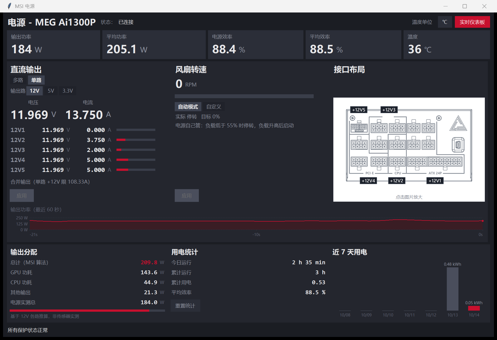
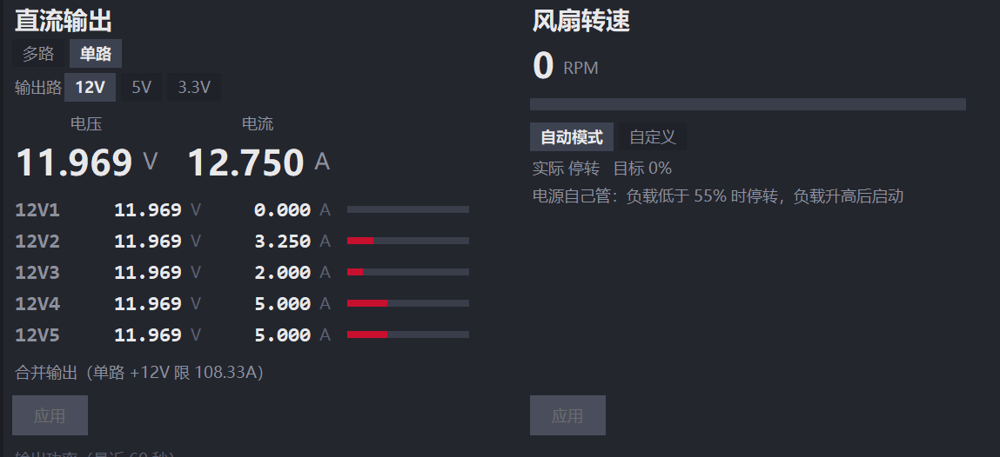
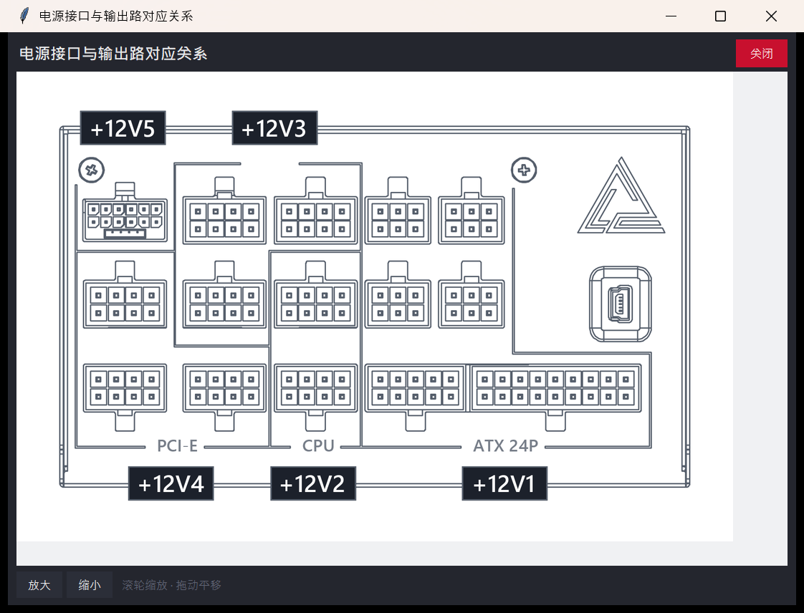
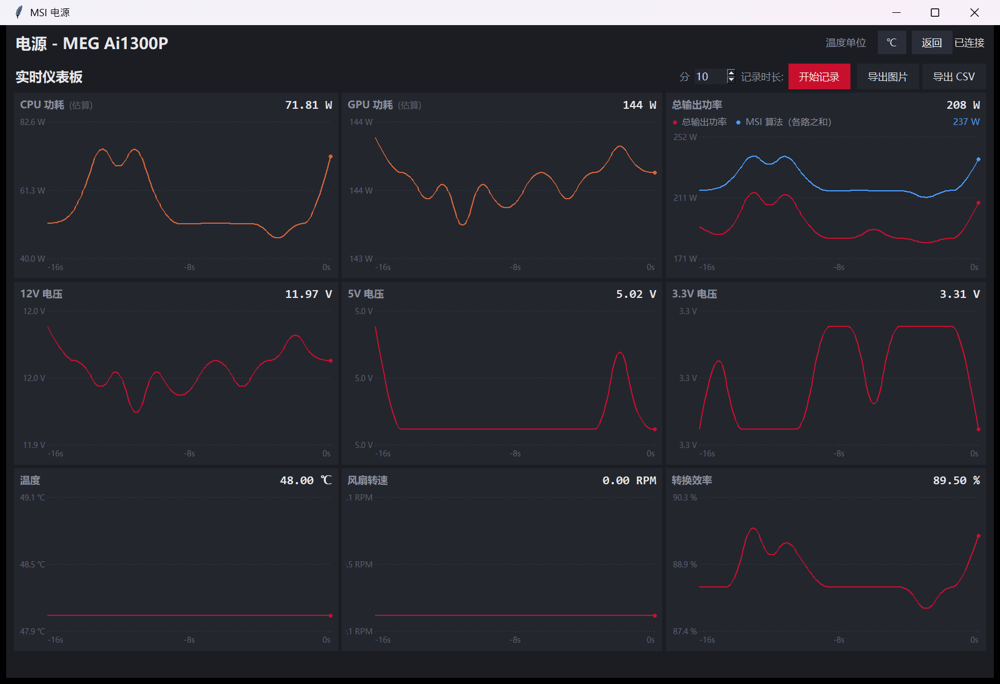

# msi-psu — MSI 电源独立控制工具

从 **MSI Center** 中剥离出的 MSI 电源（PSU）模块，不依赖 MSI Center 主程序、
不需要安装 UWP 应用、不需要管理员权限。

在 **MEG Ai1300P PCIE5** 上完整实测通过。



---

## 这是什么

MSI Center 的"Power Supply Unit"组件本质上只是一个 **HID 客户端**：
它通过 Windows 自带的 `HidUsb` 驱动，向电源的厂商自定义 HID 接口
（`usage_page 0xFF00`）收发 65 字节报文。

本项目把这套协议完整还原出来并重新实现，因此可以：

- **只读监控**：电压、电流、功率、效率、温度、风扇、告警
- **写入控制**：风扇模式/转速、ZeroFan、多路 OCP
- **与原程序共存**：MSI Center 可以同时运行，互不干扰

## 支持的型号

| 型号 | Product ID | 备注 |
|---|---|---|
| MEG Ai1000P | `0xE749` | |
| **MEG Ai1300P PCIE5** | `0x56D4` | 本机型号，已完整实测 |
| MEG Ai1600T | `0xC9EB` | |
| MPG Ai1300TS | `0xAA6F` | 支持 12V-2x6 逐针脚电流 + OCP 配置 |
| MPG Ai1600TS | `0x808C` | 同上 |

均使用 `VID 0x0DB0`。协议按型号分支，代码里已实现对应的能力差异
（例如 Ai1300P 不支持蜂鸣器开关和 12V-2x6 OCP）。

---

## 图形界面（主要用法）

**双击 `dist\MSI PSU Control.exe`** 即可，界面为**简体中文**。

界面按 MSI Center 原版 `UC_Power Supply Unit.dll`（已反编译）的布局重建，
分**两个页面**，右上角按钮切换：

### 页面一：主界面

```
标题行        电源 - MEG Ai1300P            [℃]  [实时仪表板]  已连接
统计行        输出功率 | 平均功率 | 电源效率 | 平均效率 | 温度
直流输出      ( ) 多路  ( ) 单路      合并输出
              输出路 [12V v]  电压/电流
              大字电压/电流
              12V1..12V5 逐路 V / A + 负载条
              [应用]
              输出功率实时曲线（最近 60 秒）
风扇转速      转速 RPM + 负载条
              ( ) 性能模式  ( ) 自定义
              转速滑杆 0-100%
              [应用]
用电统计      今日运行 / 累计运行 / 累计用电 / 平均效率
              [重置统计]
近 7 天用电   柱状图
底部          保护告警状态 + 12V-2x6 各针脚电流（TS 型号）
```

**直流输出与风扇区域细节：**



**点击接口示意图可放大查看接线对应关系：**



**用电统计与近 7 天用电（柱状图带 kWh 单位）：**


### 页面二：实时仪表板

点右上角 **「实时仪表板」** 进入，**「返回」** 回到主界面。



9 个滚动曲线图，与原版 `UC_Dashboard_Page` 的图表集合和顺序一致：

| 图表 | 说明 |
|---|---|
| CPU 功耗 | ⚠️ **估算值**，见下方说明 |
| GPU 功耗 | ⚠️ **估算值** |
| 总输出功率 | 实测 |
| 12V / 5V / 3.3V 电压 | 实测 |
| 温度 | 实测 |
| 风扇转速 | 实测 |
| 转换效率 | 实测 |

每个图表自动缩放 Y 轴、显示当前值、保留最近 300 个采样点（5 分钟）。

工具栏（对应原版功能）：

- **开始记录 / 停止记录** —— 可设时长（默认 10 分钟），到时自动停止
- **导出 CSV** —— 带中文表头，UTF-8 BOM（Excel 直接打开不乱码）
- **导出图片** —— 保存仪表板截图（需要 Pillow，可选）

#### ⚠️ CPU/GPU 功耗是估算，不是传感器

原版就是这么算的，我照实还原并**明确标注「估算」**：

```
CPU 功耗 = 12V2电压 × 12V2电流
GPU 功耗 = 12V3×I3 + 12V4×I4 + 12V5×I5
总功耗   = 实测值（不用估算）
```

这假设了电源的各路输出按 "CPU / GPU / 其余" 接线。这是 MSI 主板上的常见约定，
但**终究是假设** —— 如果你的接线方式不同，这两个数字就没有意义。
其余 7 个图表都是真实测量值。


### 显示缩放（字体清晰度）

程序已声明 **per-monitor-v2 DPI 感知**。之前字体发虚的原因是进程
DPI 不感知：系统缩放 150% 时，Windows 先按 96 DPI 渲染窗口，
再把成品位图拉伸 1.5 倍 —— 这一拉伸就是发虚的来源。

实测数据：

| | 修复前 | 修复后 |
|---|---|---|
| 系统真实 DPI | 144 (150%) | 144 (150%) |
| 进程看到的 DPI | 96 | 144 |
| 窗口实际像素 | 1180（被拉伸） | 1770（原生） |
| 文字渲染 | 拉伸模糊 | 原生清晰 |

窗口尺寸会随缩放自适应（win_dpi.py）。

### 与原版功能的对应关系

| MSI 原版功能 | 本工具 |
|---|---|
| Output Wattage / AVG Wattage | ✅ |
| PSU Efficiency / AVG Efficiency | ✅ |
| Temperature（℃/℉ 切换） | ✅ |
| DC Output 多路/单路切换 | ✅ 对应 OCP 开关 |
| 12V1..12V5 逐路电压电流 | ✅ 另加负载条 |
| Fan Performance / Customized | ✅ 与原版相同的两个模式 |
| 风扇滑杆 | ✅ |
| Daily Activity / Total Time | ✅ |
| Total kWh | ✅ |
| 7 天功耗柱状图 | ✅ |
| **实时仪表板（9 图滚动）** | ✅ |
| **定时记录 + CSV 导出** | ✅ |
| **导出 PNG 截图** | ✅ |
| 保护告警 | ✅ 底部状态行（原版是弹窗） |
| GPU Safeguard | ⚠️ 需 TS 型号硬件 |
| Zero fan | ⚠️ 本机不支持，见下 |

### 本工具额外增加的（原版没有）

- **逐路负载条**：一眼看出哪路吃紧
- **电压颜色告警**：偏离 ATX ±5% 变黄/变红
- **JSON 输出**：`msi-psu-cli.exe --json status`
- **原始命令通道**：`raw read/write`，协议调试用
- **英文界面**：设 `MSI_PSU_LANG=en` 环境变量即可切回英文

### 命令行用法

`dist\msi-psu-cli.exe` 提供同样的功能，适合脚本：

```powershell
.\dist\msi-psu-cli.exe status
.\dist\msi-psu-cli.exe watch
.\dist\msi-psu-cli.exe fan --list-modes   # 探测本机支持哪些风扇模式
.\dist\msi-psu-cli.exe fan --mode 3 --duty 45
.\dist\msi-psu-cli.exe ocp on
.\dist\msi-psu-cli.exe --json status
```

两个 exe 都是单文件、免 Python。GUI 版是 windowed 子系统（无控制台），
所以不可能出现黑框闪退；CLI 版保留控制台并已修正中文编码。

### 风扇模式是设备决定的，不是固定的

MSI 原版界面**只提供两个风扇模式**：`Performance`（模式值 1）和
`Customized`（模式值 3）。这与实测完全吻合 —— 本机 **MEG Ai1300P 只接受
`silent`(1) 和 `custom`(3)**，写入 `auto`(0) / `balanced`(2) 会被设备**拒绝**。

（注意命名差异：原版 UI 把模式 1 叫 "Performance"，协议层的数据手册叫
"silent"；两者是同一个值。）

界面会自动探测并只显示可用项；命令行可用 `fan --list-modes` 查看。
如果强行指定不支持的模式，会明确报错而不是假装成功。

### Zero fan 在本机不可用

MSI 原程序对所有型号都会调用 `ZERO_FAN_ENABLE`（命令 67），但**本机设备
根本不回应该命令** —— 三次连续尝试、每次清空输入缓冲后都超时无应答，
风扇状态也毫无变化。

因此本工具**不提供 Zero fan 开关**（只读显示当前状态），避免给你一个
按了没反应的按钮。原版 MSI Center 里同样没有这个开关，属于它的隐藏逻辑。

## 安装

只需要 Python 3 和 `hidapi`：

```powershell
python -m pip install hidapi
```

无需管理员权限 —— 设备挂的是系统自带 `HidUsb` 驱动，普通用户态即可读写。

## 使用

```powershell
cd msi-psu-tool

python src\msi_psu.py info        # 设备身份
python src\msi_psu.py status      # 完整遥测快照
python src\msi_psu.py watch       # 实时刷新（Ctrl-C 退出）
python src\msi_psu.py watch --json -i 2   # 每 2 秒输出一行 JSON

python src\msi_psu.py fan                    # 读取风扇状态
python src\msi_psu.py fan --mode 1           # 设为静音 (0=auto 1=silent 2=balanced)
python src\msi_psu.py fan --mode 3 --duty 60 # 自定义 60%

python src\msi_psu.py zerofan            # 读取
python src\msi_psu.py zerofan on         # 开启零风扇模式

python src\msi_psu.py ocp                # 读取多路 OCP
python src\msi_psu.py ocp on             # 开启多路 OCP

python src\msi_psu.py alerts             # 保护告警状态
python src\msi_psu.py runtime            # 运行时长
python src\msi_psu.py raw read 224       # 发送任意命令（协议探索用）
```

所有命令都支持 `--json`，便于脚本和监控集成。

### 实际输出示例

```
MEG Ai1300P  (PID 0x56D4, rev 1.0)

Rails
  12V    11.969 V   13.750 A
  12V1   11.969 V    0.000 A
  12V2   11.969 V    4.250 A
  12V3   11.969 V    2.000 A
  12V4   11.969 V    5.000 A
  12V5   11.969 V    5.000 A
  5V      5.016 V    2.188 A
  3.3V    3.320 V    3.125 A

Power
  Output     :   184.00 W
  Input      :   208.20 W   (derived)
  Efficiency :    88.38 %
  AC input   :    225.0 V

Thermal
  Temperature:     46.0 C
  Fan speed  :        0 RPM
  Fan mode   : 1 (silent)

Health
  Alerts     : all OK
  Multi-rail OCP : False
  Runtime now    : 4158 s (1.16 h)
```

---

## 协议说明

这一节是逆向的结论，供后续维护和移植使用。

### 报文格式

65 字节 HID 报文，**byte 0 是 Report ID（恒为 0）**：

| 偏移 | 含义 |
|---|---|
| `[0]` | Report ID = 0 |
| `[1]` | 操作码：`0x51`(81) 读 / `0x50`(80) 写 / `0xFA`(250) 握手 |
| `[2]` | 命令码 |
| `[3..]` | 负载 |

设备在输入报文中**回显**操作码和命令码，必须靠这个回显匹配应答。
电源还会主动上报无关报文，因此收到不匹配的帧要丢弃，不能当成应答。

### 数值编码（关键）

16 位小端，**11 位尾数 + 5 位有符号指数**（Linear11）：

```
exponent = ((high << 24) 按 int32 解释) >> 27
mantissa = ((high & 0x07) << 8) | low
value    = mantissa * 2**exponent
```

⚠️ **这里的 32 位有符号溢出是必须的**。当 `high >= 0x80` 时，
`high << 24` 在 int32 中溢出为负数，`>> 27` 得到负指数。

用无符号算术重写会得到完全错误的结果 —— 例如 12V 的
`FE D2` 会从正确的 **11.97 V** 变成约 **5×10⁸**。

（这也是一个容易误判的陷阱：`0xFE` 出现在 byte 3 时，
原程序会把它当错误码；实际上它只是尾数的低字节。）

### 命令码

| 命令 | 码 | 命令 | 码 |
|---|---|---|---|
| `MFR_ID` | 16 | `FAN_SPEED` | 64 |
| `MFR_MODEL` | 17 | `FAN_SETTING` | 65 |
| `MFR_REVISION` | 18 | `READ_FANDUTY` | 66 |
| `MFR_SERIAL` | 19 | `ZERO_FAN_ENABLE` | 67 |
| `VIN` | 32 | `MULTIRAIL_OCP` | 192 |
| `VOUT_12V5` | 34 | `OCP12V2x6_CONFIG` | 192 |
| `IOUT_12V5` | 35 | `OCP12V2x6_STATE` | 193 |
| `VOUT_12` | 36 | `BUZZER_SWITCH` | 194 |
| `IOUT_12` | 37 | `RUNTIME_NOW` | 208 |
| `VOUT_5` / `IOUT_5` | 38 / 39 | `RUNTIME_TOTAL` | 209 |
| `VOUT_3_3` / `IOUT_3_3` | 40 / 41 | `READ_ALL` | 224 |
| `POUT` / `EFFICIENCY` | 42 / 43 | `READ_ALERTSTATUS` | 225 |
| `IOUT_12V2x6` | 44 | `SAVE_SETTING` | 241 |
| `TEMPERATURE` | 48 | | |

### `READ_ALL` 字段布局（Ai1000P / Ai1300P）

从 byte 3 起，连续 20 组 16 位数值：

```
V_12V1, I_12V1, V_12V2, I_12V2, V_12V3, I_12V3, V_12V4, I_12V4,
V_12V5, I_12V5, V_12V,  I_12V,  V_5V,   I_5V,   V_3V3,  I_3V3,
P_Out,  Eff,    Temp,   Fan_Speed
```

其它型号布局不同，代码里按 PID 分支处理。

### 状态字节的真实含义（重要）

应答报文回显操作码和命令码，但**成功与否由 byte 3 单独表示**，
而且它**回显被接受的值**，不是简单的 0/1：

| 操作 | byte 3 | 含义 |
|---|---|---|
| `FAN_SETTING` mode 1 (silent) | `0x01` | 接受 |
| `FAN_SETTING` mode 2 (balanced) | `0xFE` | **拒绝**（本机不支持） |
| `FAN_SETTING` mode 3 (custom) | `0x03` | 接受 |
| `MULTIRAIL_OCP` enable | `0x02` | 接受 |
| `SAVE_SETTING` | `0xFC` | 接受（无负载） |

**`0xFE` 表示拒绝。** 早期版本把"收到回显"一律当作成功，
导致界面显示"风扇模式已设为 balanced"而设备其实纹丝不动 ——
这是本项目修复过的一个真实 bug，改动时务必保留这个判断。

### 多进程互斥

原程序使用全局互斥体 `Global\MSI_PSU_Mutex` 串行化设备访问。
本工具会**尽力**获取同一个互斥体：

- MSI Center 由 SYSTEM 服务创建该对象，普通进程无法*创建*全局对象
  （需要 `SeCreateGlobalPrivilege`），但通常可以*打开*已存在的对象
- 两者都失败时降级为不加锁 —— 这是安全的，因为协议本身靠回显匹配
  应答，其它写入者的帧会被丢弃而不是误读

---

## 能否脱离 MSI Center 单独使用？

**可以。** 这次不是推理，是查了驱动栈的硬证据。

### 驱动栈：从头到尾都是微软的

用 `pnputil` 和 PnP 属性逐层查了 PSU 的完整设备栈：

```
HID-compliant vendor-defined device      inf=input.inf      (Microsoft)
USB Input Device                         svc=HidUsb         (Microsoft)
Generic USB Hub                          svc=USBHUB3        (Microsoft)
USB Root Hub (USB 3.0)                   svc=USBHUB3        (Microsoft)
AMD USB 3.10 eXtensible Host Controller  svc=USBXHCI        (Microsoft)
... PCI / ACPI ...
```

关键几项：

| 检查项 | 结果 |
|---|---|
| 驱动提供者 | `Microsoft` |
| 驱动签名者 | `Microsoft Windows` |
| 驱动版本 | `10.0.26100.9549`（Windows 自带 `input.inf`） |
| **UpperFilters** | **空**（无过滤驱动） |
| **LowerFilters** | **空**（无过滤驱动） |
| CoInstallers | 空 |
| DriverStore 中的 MSI 驱动 | **一个都没有** |
| 设备枚举器 | `HID`（硬件枚举，非软件虚拟） |

**没有过滤驱动**这一条最关键：如果 MSI 在设备栈里插了过滤驱动，
卸载 MSI Center 就可能连带破坏设备。实测两者都是空的。

### MSI 确实装了两个内核驱动，但都与电源无关

| 驱动 | 路径 | 用途 |
|---|---|---|
| `MSIO` | `system32\drivers\MsIo64.sys` | MICSYS 端口 I/O，用于主板 EC/SMBus |
| `NTIOLib_CC_COMM` | `MSI Center\Lib\SYS\NTIOLib_X64.sys` | 端口 I/O 库 |

这两个**都不在 PSU 的设备栈里**（PSU 走标准 `HidUsb`）。
它们是给主板传感器/EC 用的，而本机是 ASUS 主板，实际用不上。

### 已实测的部分

- **代码零依赖**：只 import `hid`、`ctypes`、`time`，无任何 MSI 路径/注册表引用
- **驱动来自微软**：如上，PSU 设备栈无 MSI 组件
- **无锁可用**：强制 `Global\MSI_PSU_Mutex` 不可用时功能完整
- **无 Python 可用**：exe 在清空 PATH 的隔离目录里正常工作
- **MSI 进程被扰动后仍可用**：杀掉 `MSI.CentralServer` / `MSI.TerminalServer`
  后工具照常读取（这些进程会被 SYSTEM 服务自动拉回，所以只算弱证据）

### 我没能验证的

**我无法真正卸载 MSI Center 来验证** —— 卸载需要管理员权限且不可逆，
这是你的决定，不该由我执行。而且 `MSI_Center_Service` 以 SYSTEM 运行，
普通权限杀不掉它的进程。

但上面的证据覆盖了"卸载后会不会坏"的全部机制：
驱动是微软的、没有过滤驱动、没有 co-installer、DriverStore 里没有 MSI 驱动包。
卸载 MSI Center 只会删掉它自己的用户态程序，**不会动这个设备**。

如果你要卸载，建议：

1. 先备份 `C:\Program Files (x86)\MSI\MSI Center\Power Supply Unit\`
2. 用 `dist\MSI PSU Control.exe` 确认能正常读到数据
3. 再卸载 MSI Center，然后重新确认

## 独立打包与免 Python 运行

两个 exe 都是**单文件、免 Python**，已在清空 `PATH` 的隔离目录中验证。

| 文件 | 用途 |
|---|---|
| `dist\MSI PSU Control.exe` | 图形界面，双击运行（windowed 子系统，无控制台） |
| `dist\msi-psu-cli.exe` | 命令行，适合脚本 |

重新构建：

```powershell
python -m pip install pyinstaller

# GUI（无控制台黑框）
python -m PyInstaller --onefile --windowed --name "MSI PSU Control" `
  --paths src src\msi_psu_app.py

# CLI（保留控制台）
python -m PyInstaller --onefile --console --name "msi-psu-cli" `
  --paths src src\msi_psu.py
```

### 也可以只拷源码

只依赖 `hidapi` 一个第三方包：

```powershell
python -m pip install hidapi
python src\msi_psu.py status          # 命令行
python src\msi_psu.py                 # 无参数 = 打开图形界面
```

## 已知限制

- **12V-2x6 OCP（`ocp-pcie5`）未在真机验证**：该功能只存在于 MPG Ai1300TS /
  Ai1600TS，本机是 Ai1300P，无此能力，因此写入路径只做了代码级还原
  （严格照抄原程序的 `(value << 4)` + `0xE0` 编码），**未经硬件实测**。
  如果你之后换了 TS 型号，建议先用 `ocp-pcie5`（读取）确认当前值，
  再小步修改。
- **原程序 getter 的编码存疑**：原 `OCP_Config_12V2x6.OCP_Point` 的 getter
  用 `ValueCalc` 解码 `(value<<4, 0xE0)`，按 Linear11 算出来是 `0.0024` 而不是
  `10`。本实现**忠实照抄了原行为**（不做"修正"），因为无法确认设备实际回读
  的字节布局。读取到的值若不合常理，属于原程序遗留问题而非本工具引入。
- **序列号为空**：本机电源不回报 `MFR_SERIAL`，属设备行为。
- 原 MSI Center 的上层功能（按日 kWh 统计、告警弹窗、UWP 界面）不在范围内。

## 与 MSI Center 的关系

- **可以共存**：MSI Center 服务照常运行，其每分钟的配置记录不受影响
- **可以卸载 MSI Center**：本工具不读取 MSI Center 的任何文件或注册表
- 原程序的部分功能（如按日统计的 kWh 报告、告警弹窗）属于 MSI Center
  的上层逻辑，不在本工具范围内

## 安全提示

- 只读命令（`info` / `status` / `watch` / `alerts` / `runtime`）**不写入设备**
- 写命令（`fan` / `zerofan` / `ocp`）会持久化到电源，请确认参数合理
- `ocp` 相关设置改动前建议先记录原值；错误阈值可能导致意外断电保护
- 本项目按型号做了能力守卫，不支持的型号会明确拒绝而不是乱写

## 文件

| 文件 | 说明 |
|---|---|
| `dist\MSI PSU Control.exe` | 图形界面（单文件，免 Python） |
| `dist\msi-psu-cli.exe` | 命令行（单文件，免 Python） |
| `src/psu_protocol.py` | 协议库（设备发现、传输、编解码、全部命令、能耗统计） |
| `src/msi_psu_gui.py` | 图形界面（按 MSI 原版布局） |
| `src/msi_psu_app.py` | GUI 版打包入口 |
| `src/msi_psu.py` | 命令行界面 |
| `src/test_standalone.py` | 脱离 MSI Center 的独立性测试 |
| `src/screenshot.py` | 窗口截图工具（验证界面用） |
| `out_main.png` 等 | 界面截图 |
| `assets/` | 接口示意图（来源见「来源与授权」） |

## 来源与授权

协议通过静态分析 MSI 官方发布的 `API_Power Supply Unit.dll`
（MSI Center 组件，v1.0.0.36）获得，并对照真实硬件验证。

本项目为互操作性目的独立实现，源代码为原创。
仓库不包含 MSI 的反编译输出；协议结论以本项目的独立实现与硬件实测为准。
`assets/` 下的接口示意图来自 MSI Center 组件，仅作互操作性说明之用，
如权利人要求可移除（移除后「接口布局」功能会自动跳过，不影响其他功能）。
MSI、MEG、MPG 是 Micro-Star International 的商标。
请仅在你拥有或获授权使用的硬件上使用。

## 许可证

本项目采用 [MIT 许可证](LICENSE)。

代码可自由使用、修改、分发（含商业用途），只需保留版权声明。
`assets/` 下的接口示意图不属于本项目的授权范围，其权利归 MSI 所有。

